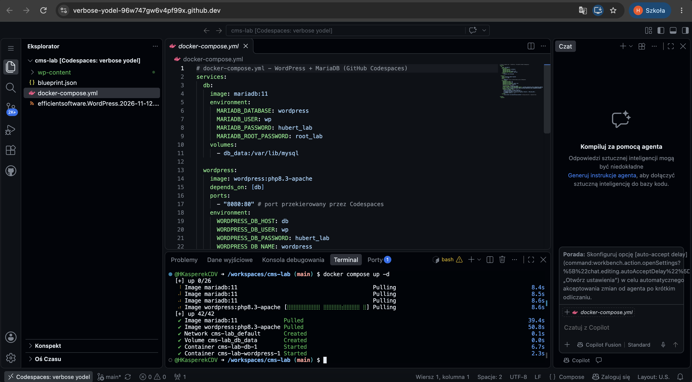
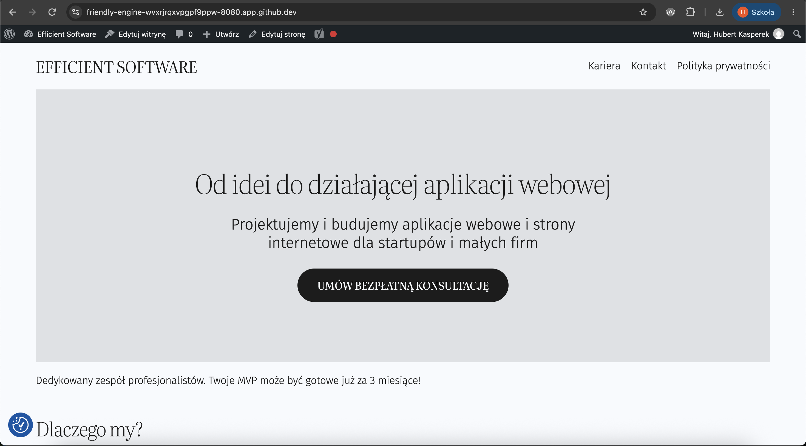
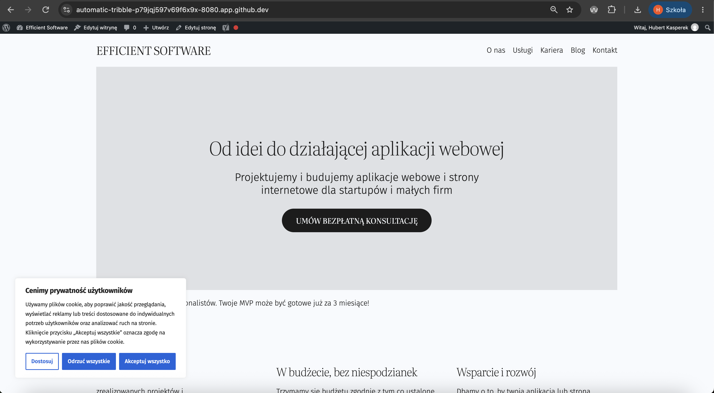
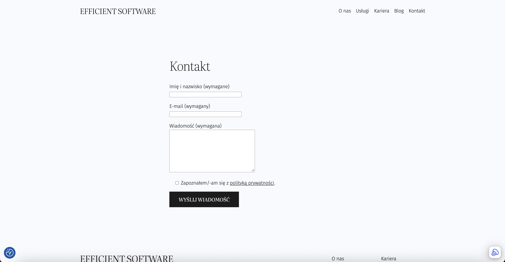
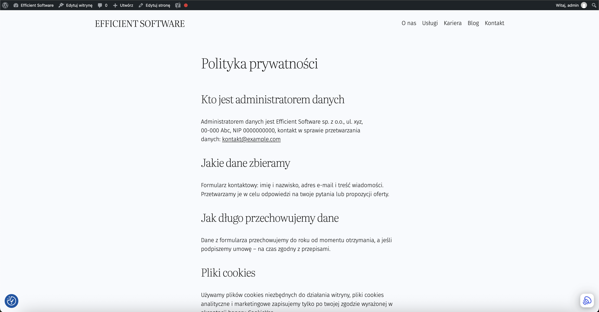
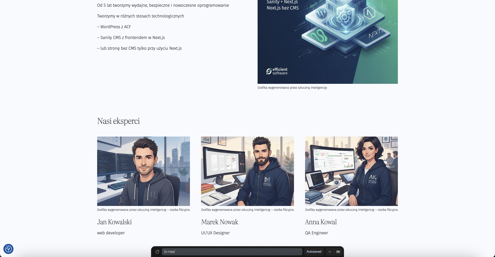
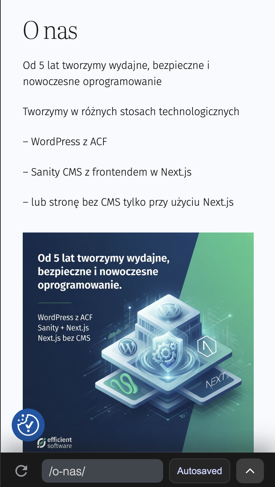
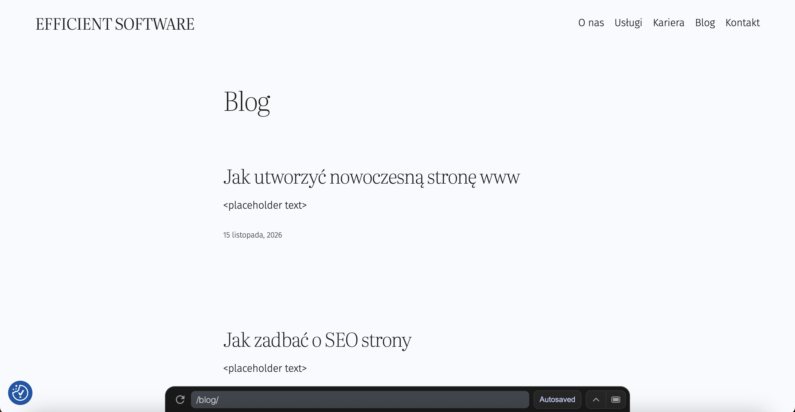
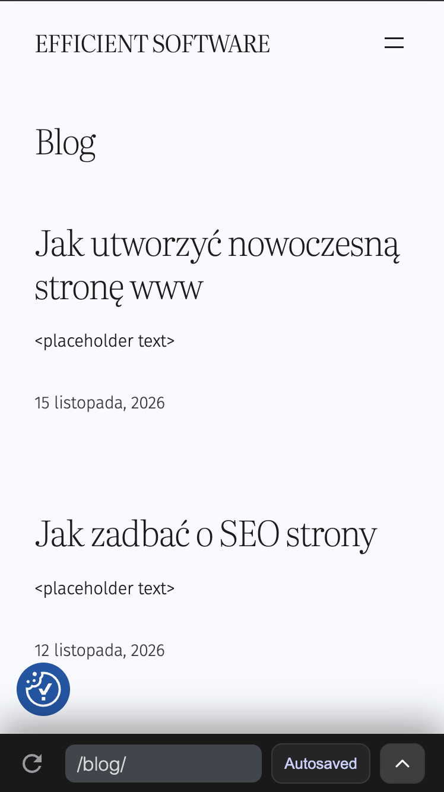
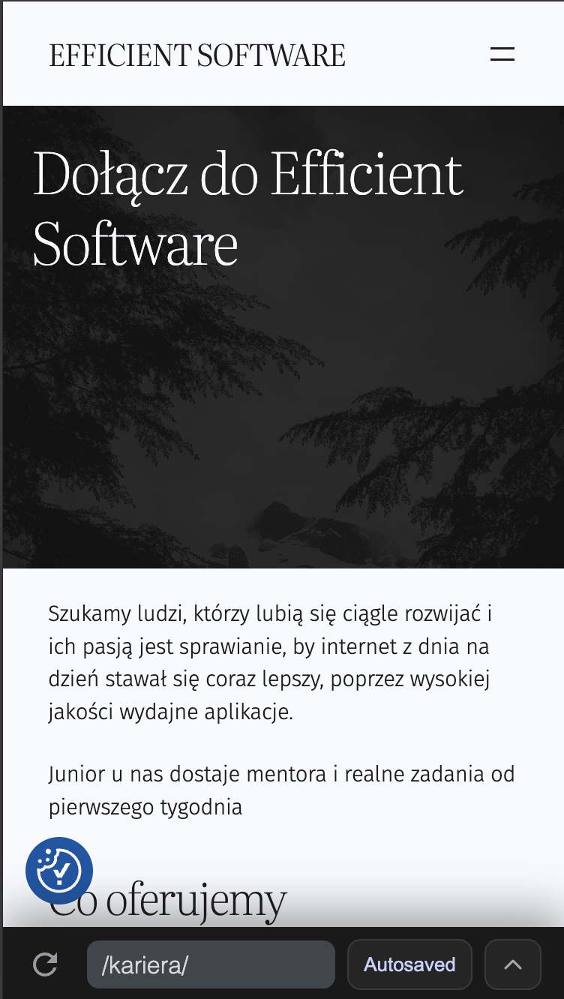

# MP1

update po 14.11.2026

update po 19.11.2026

Autor: Hubert Kasperek

**Demo z Wordpress Playground**
[Otwórz](https://playground.wordpress.net/?blueprint-url=https://raw.githubusercontent.com/HKasperekCDV/cms-lab/refs/heads/main/blueprint.json)

## Informacje
nazwa fikcyjnej firmy: Efficient Software

slogan: "Od idei do działającej aplikacji webowej"

Branża: Software House

Oferta:
- strony firmowe na Wordpress wraz z ACF
- aplikacje webowe Next.js + Sanity CMS
- sam frontend w Next.js
- utrzymanie i rozwój aplikacji po wdrożeniu
Grupa docelowa:
- małe firmy bez własnej strony internetowej lub chcące mieć redesign strony (nową stronę)
- kandydaci na pracownika

## Persony
1. Marta - założycielka startupu, potrzebuje strony internetowej
   - cel: zbudować mvp aplikacji w 3 miesiące
   - user flow: Homepage -> Usługi -> Kontakt
   - urządzenie: laptop - przegląda różne agencje oferujące tworzenie i utrzymanie aplikacji internetowych
2. Jacek - web developer, student szukający pierwszej pracy jako junior web developer
   - cel: znaleźć pierwszą pracę w firmie, w jakiej będzie się rozwijać
   - user flow: Homepage -> Kariera -> Kontakt
   - urządzenie: smartfon - przegląda strony i oferty w przerwach między zajęciami

## Mapa strony
- Strona główna
- O nas - historia firmy, stosy technologiczne, przykładowi eksperci
- Usługi - oferta i wybrane ukończone projekty (podstrona dla persony Marta)
- Kariera - oferty pracy, benefity, krótkie wyjaśnienie procesu rekrutacji (podstrona dla persony Jacek)
- Blog - artykuły blogowe od ekspertów (użyte placeholdery, ale na realnej stronie artykuły mogłyby zwiększać pozycjonowanie strony w SEO)
- Kontakt - formularz Contact Form 7
- Polityka prywatności

## Zrzuty ekranu

### Strona główna

#### Desktop

#### Mobile

### Usługi

#### Desktop

#### Mobile

### Kontakt

#### Desktop

#### Mobile

### Polityka prywatności

#### Desktop

#### Mobile

### O nas

#### Desktop

#### Mobile

### Blog

#### Desktop

#### Mobile

### Kariera

#### Desktop

#### Mobile

## Wtyczki
Contact Form 7 - dla formularza kontakowego

Classic Honeypot for Contact Form 7 - ochrona przed spamem bez CAPTCHA ([WCAG 3.3.8](https://www.w3.org/WAI/WCAG22/Understanding/accessible-authentication-minimum.html))

Yoast SEO - optymalizacja SEO (dla lepszego pozycjonowania w np Google) pod wyszukiwarki

CookieYes - baner cookies 

## Uzasadnienie wyboru CMS
WordPress jest najpopularniejszym CMS'em, ma ogromny ekosystem wtyczek, dzięki jego popularności łatwo jest znaleźć developera jaki zna
WordPressa, w porównaniu np do Wix czy Sanity - WordPress jest self-hosted, czyli nie mamy vendor lock, możemy sami go hostować gdzie chcemy i mamy kontrolę nad kodem i danymi

## Uruchomienie projektu
można jednym kliknięciem korzystając z linka podanego wyżej dla wersji z Demo Playground, natomiast dla wersji w codespaces, 
po uruchomieniu codespaces wystarczy wpisac **docker compose up -d** w terminalu by uruchomić, przygotować WordPressa, zrobić import w:

Narzędzia -> import -> Wordpress i wczytać plik **efficientsoftware.WordPress.2026-11-12.xml** dostępny w repozytorium

## Raporty Lighthouse

### Strona główna / homepage
[Test wykonany na desktop](https://hkasperekcdv.github.io/cms-lab/homepage-destop.html)

[Test wykonany na mobile](https://hkasperekcdv.github.io/cms-lab/homepage-mobile.html)

### Kontakt
[Test wykonany na desktop](https://hkasperekcdv.github.io/cms-lab/kontakt-desktop.html)

[Test wykonany na mobile](https://hkasperekcdv.github.io/cms-lab/kontakt-mobile.html)

Accessibility ocenione na "100" w LightHouse, nie wymaga poprawek

## Użycie AI
Claude - poprawienie docker-compose.yml, kasowanie domyślnych postów w cms, import wxr i setSiteOptions w blueprint.json

Google Gemini (konto uczelniane) - grafiki w folderze `grafiki-ai/`, odpowiednio podpisane na stronie **Grafika wygenerowana przez sztuczną inteligencję**

## Źródła i licencje

### Motyw i CMS
Wordpress - [GPLv2 lub nowsza](https://wordpress.org/about/license/)
 
Motyw Twenty Twenty-Five - GPLv2 lub nowsza

### Wtyczki
Contact Form 7 - [GPLv2 lub nowsza](https://github.com/rocklobster-in/contact-form-7?tab=License-1-ov-file)

Classic Honeypot for CF7 - GPLv2 lub nowsza

Yoast SEO - GPLv3

CookieYes - GPLv3

Co oznacza GPL - oprogramowanie można używać (w tym komercyjnie), modyfikować i rozpowszechniać - przy rozpowszechnianiu wersji trzeba udostępnić ją na tej samej licencji. Sama treść naszej strony (teksty lub grafiki) nie muszą być na GPL

## Fonty
Użyte donty to te dołączone do motywu Twenty Twenty-Five i serwowane lokalnie z serwera strony (czyli nie mamy tutaj Google Fonts CDN, czyli nie przekazujemy adresu IP użytkownika do Google zgodnie z RODO [GDPR])

Literata - SIL Open Font License 1.1

Fira Sans - SIL Open Font License (SIL OFL, Version 1.1)

Co oznacza licencja OFL? font wolno używać, osadzać na stronie, modyfikować i rozpowszechniać wraz z oprogramowaniem, ale nie wolno sprzedawać samego pliku fontu

### Grafiki
Grafiki w folderze `grafiki-ai/` - wygenerowane przez sztuczną inteligencję - Google Gemini, konto uczelniane

Zdjęcie w banerze (Kariera) - CC0 1.0

Grafiki na stronie wygenerowane przy użyciu generatywnej sztucznej inteligencji są oznaczone na stronie podpisem (w tym wizerunki osób jako osoby fikcyjne). Zdjęcia/obrazki na CC0 można używać bez zgody i podawania autora

### Ikony
Strona nie używa zewnętrznych zestawów ikon. Ikony pochodzą z rdzenia WordPressa - GPLv2 lub nowsza

