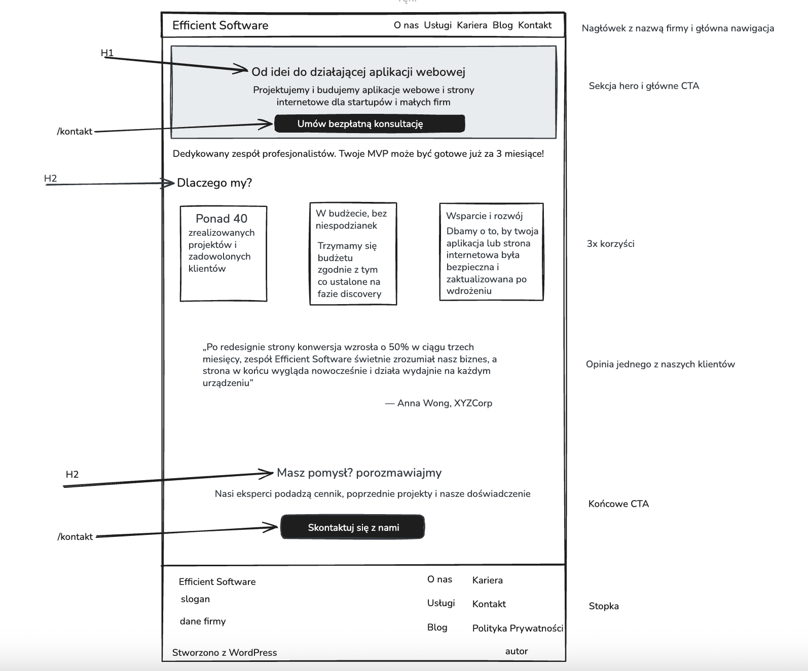
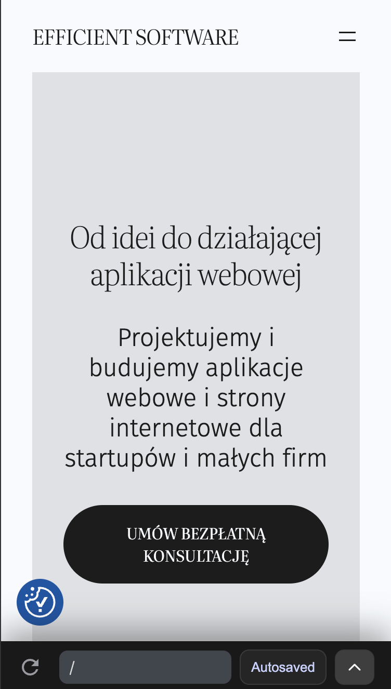
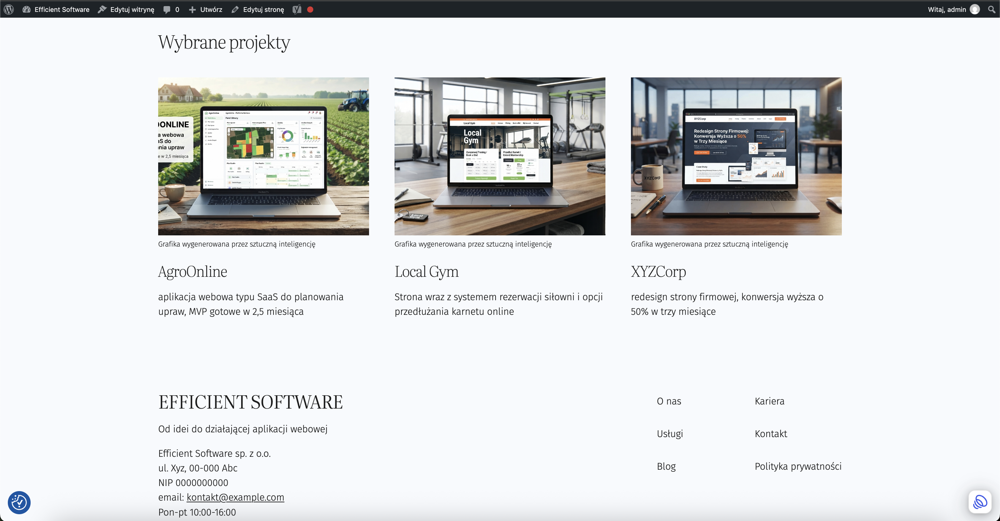
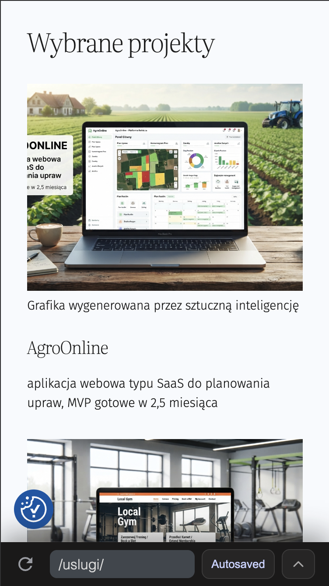
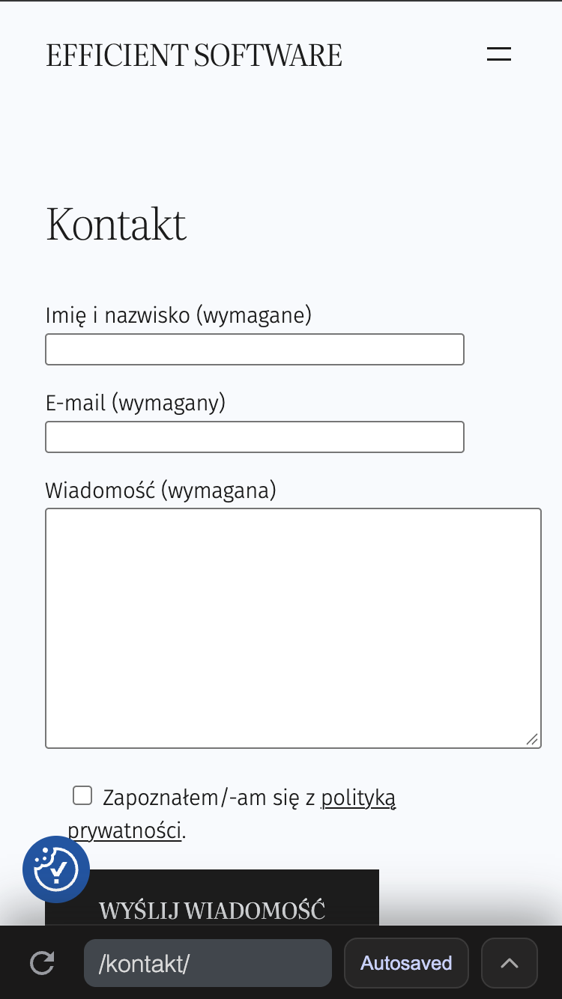
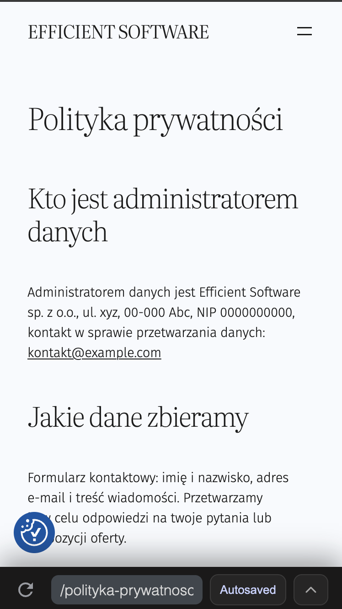
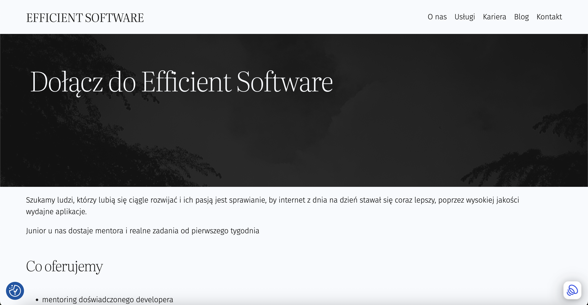

# MP1

Autor: Hubert Kasperek

**Demo z Wordpress Playground**
[Otwórz](https://playground.wordpress.net/?blueprint-url=https://raw.githubusercontent.com/HKasperekCDV/cms-lab/refs/heads/main/blueprint.json)

## Informacje
nazwa fikcyjnej firmy: Efficient Software

slogan: "Od idei do działającej aplikacji webowej"

Branża: Software House

Oferta:
- strony firmowe na Wordpress wraz z ACF
- aplikacje webowe Next.js + Sanity CMS
- sam frontend w Next.js
- utrzymanie i rozwój aplikacji po wdrożeniu
Grupa docelowa:
- małe firmy bez własnej strony internetowej lub chcące mieć redesign strony (nową stronę)
- kandydaci na pracownika

## Persony
1. Marta - założycielka startupu, szuka Software House, jaki zbuduje MVP jej aplikacji webowej
   - cel: zbudować mvp aplikacji w 3 miesiące
   - problem: nie ma zespołu technicznego, nie wie jakiej agencji zaufać, boi się o budżet i termin wykonania
   - user flow: Homepage -> Usługi -> Kontakt
   - urządzenie: laptop - przegląda różne agencje oferujące tworzenie i utrzymanie aplikacji internetowych
   - CTA: kliknięcie "Umów bezpłatną konsultację" i wysłanie formularza kontaktowego, zgodnie z user flow
2. Jacek - web developer, student szukający pierwszej pracy jako junior web developer
   - cel: znaleźć pierwszą pracę w firmie, w jakiej będzie się rozwijać
   - problem: nie ma doświadczenia komercyjnego, a większość ofert jakie widzi szuka senior developerów, nie wie, jaka firma przyjmie go na stanowisko juniorskie
   - user flow: Homepage -> Kariera -> Kontakt
   - urządzenie: smartfon - przegląda strony i oferty w przerwach między zajęciami
   - CTA: zgłoszenie się na ofertę junior web developera poprzez formularz kontaktowy, przechodząc zgodnie z user flow

## Decyzje projektowe
- motyw Twenty Twenty-Five, wygląd zedytowany w Stylach globalnych
- kolory: głównie jasne tło (białye lub jasnoszare) z ciemnym tekstem, w CTA odwrotnie - ciemne tło a jasny tekst
- navbar ułożony zgodnie z mapą strony i ściezkami person podanych wyzej
- sekcja Hero z strony głównej zapisana jako wzorzec "Hero z CTA" i użyta ponownie na stronie Usługi
- Grafiki wygenerowane przez generatywną sztuczną inteligencję Gemini i oznaczone na stronie w odpowiedni sposób

## Mapa strony
- Strona główna
- O nas - historia firmy, stosy technologiczne, przykładowi eksperci
- Usługi - oferta i wybrane ukończone projekty (podstrona dla persony Marta)
- Kariera - oferty pracy, benefity, krótkie wyjaśnienie procesu rekrutacji (podstrona dla persony Jacek)
- Blog - artykuły blogowe od ekspertów (użyte placeholdery, ale na realnej stronie artykuły mogłyby zwiększać pozycjonowanie strony w SEO)
- Kontakt - formularz Contact Form 7
- Polityka prywatności

## Wireframe strony głównej

Wykonane przy użyciu [Excalidraw Whiteboard](https://excalidraw.com/)

## Zrzuty ekranu

### Strona główna

#### Desktop

#### Mobile

### Usługi

#### Desktop

#### Mobile

### Kontakt

#### Desktop

#### Mobile

### Polityka prywatności

#### Desktop

#### Mobile

### O nas

#### Desktop

#### Mobile

### Blog

#### Desktop

#### Mobile

### Kariera

#### Desktop

#### Mobile

## Wtyczki
Contact Form 7 - dla formularza kontakowego

Classic Honeypot for Contact Form 7 - ochrona przed spamem bez CAPTCHA ([WCAG 3.3.8](https://www.w3.org/WAI/WCAG22/Understanding/accessible-authentication-minimum.html))

Yoast SEO - optymalizacja SEO (dla lepszego pozycjonowania w np Google) pod wyszukiwarki

CookieYes - baner cookies 

## Uzasadnienie wyboru CMS
WordPress jest najpopularniejszym CMS'em (zgodnie z W3Tech - stan na październik 2026, WordPress działa na 40,2% wszystkich stron i 58,7% udziału w rynku CMS, gdzie np. Wix ma 6,1%), ma ogromny ekosystem wtyczek, dzięki jego popularności łatwo jest znaleźć developera jaki zna
WordPressa, w porównaniu np do Wix czy Sanity - WordPress jest self-hosted, czyli nie mamy vendor lock, możemy sami go hostować gdzie chcemy i mamy kontrolę nad kodem i danymi

## Uruchomienie projektu
### Wersja Playground
można uruchomić [jednym kliknięciem](ttps://playground.wordpress.net/?blueprint-url=https://raw.githubusercontent.com/HKasperekCDV/cms-lab/refs/heads/main/blueprint.json)

## Wersja w Github Codespaces
1. uruchom codespace, uzyskasz wtedy okno takie jak tutaj:

2. Wpisz w terminalu `docker compose up -d`
3. Otwórz przekierowany port 8080 w nowej karcie, jak zobaczysz "Error establishing a database connection", poczekaj kilka minut i odśwież kartę
4. Zacznij instalację Wordpressa, wybierz język "Polski" i resztę konfiguracji początkowej, nazwa witryny to "Efficient Software"
5. Zaloguj sie i przejdź do **Ustawienia->Ogólne** i ustaw slogan: "Od idei do działającej aplikacji webowej"
6. Przejdź do **Ustawienia->Bezpośrednie odnośniki** i wybierz "Nazwa wpisu"
7. Przejdź do **Wtyczki->Dodaj wtyczkę**, zainstaluj i włącz, **Contact Form 7**, **Classic Honeypot for CF7**, **Yoast Seo** i **CookieYes**, po instalacji i aktywacji **CookieYes** przejdź w zakładkę **CookieYes->Języki->Lista języków->English->kliknij trzykropki (...)->Zmień język domyślny->Wybierz język domyślny->Wybierz Polish (pl) i kliknij "zmień"**
8. Usuń domyślne treści, jak Strony typu "Przykładowa strona" lub Wpisy "Witaj, świecie!"
9. Przejdź do **Narzędzia->Import->Wordpress**, kliknij "Zainstaluj", potem "Uruchom importer", wybierz plik .xml z tego repozytorium i go zaimportuj
10. Przejdź do **Ustawienia->Czytanie** zmień w "Strona główna wyświetla" z "Twoje najnowsze wpisy" na "statyczną stronę (wybierz poniżej)", w "strona główna" wybierz "Strona główna", a w "Strona z wpisami" wybierz "Blog"

## Raport Dostępności (PDF)

Pełny raport dostępności - WAVE przed i po, lista poprawek zgodnie z WCAG, kontrast

[raport w formacie pliku PDF](https://hkasperekcdv.github.io/cms-lab/raport_dostepnosci_mp1_Hubert_Kasperek.pdf)

## Pełne raporty Lighthouse

### Strona główna / homepage
[Test wykonany na desktop](https://hkasperekcdv.github.io/cms-lab/homepage-destop.html)

[Test wykonany na mobile](https://hkasperekcdv.github.io/cms-lab/homepage-mobile.html)

### Kontakt
[Test wykonany na desktop](https://hkasperekcdv.github.io/cms-lab/kontakt-desktop.html)

[Test wykonany na mobile](https://hkasperekcdv.github.io/cms-lab/kontakt-mobile.html)

Accessibility ocenione na "100" w LightHouse

## Użycie AI
Claude - poprawienie docker-compose.yml, kasowanie domyślnych postów w cms, import wxr i setSiteOptions w blueprint.json

Google Przegląd od AI - wyszukiwanie linków do licencji

Google Gemini (konto uczelniane) - grafiki w folderze `grafiki-ai/`, odpowiednio podpisane na stronie **Grafika wygenerowana przez sztuczną inteligencję**

## Źródła i licencje

### Motyw i CMS
Wordpress - autor: Wordpress.org i współtwórcy, licencja: [GPLv2 lub nowsza](https://wordpress.org/about/license/)
 
Motyw Twenty Twenty-Five - autor: Wordpress.org i współtwórcy, [GPLv2 lub nowsza](https://wordpress.org/themes/twentytwentyfive)

### Wtyczki
Contact Form 7 - autor: Rock Lobster Inc., licencja: [GPLv2 lub nowsza](https://github.com/rocklobster-in/contact-form-7?tab=License-1-ov-file)

Classic Honeypot for CF7 - autor: Nilo Velez, licencja: [GPLv2 lub nowsza](https://wordpress.org/plugins/classic-honeypot-for-cf7/)

Yoast SEO - autor: Yoast, licencja: [GPLv3](https://wordpress.org/plugins/wordpress-seo)

CookieYes - autor: CookieYes, licencja: [GPLv3](https://wordpress.org/plugins/cookie-law-info)

Co oznacza GPL - oprogramowanie można używać (w tym komercyjnie), modyfikować i rozpowszechniać - przy rozpowszechnianiu wersji trzeba udostępnić ją na tej samej licencji. Sama treść naszej strony (teksty lub grafiki) nie muszą być na GPL

## Fonty
Użyte fonty to te dołączone do motywu Twenty Twenty-Five i serwowane lokalnie z serwera strony (czyli nie mamy tutaj Google Fonts CDN, czyli nie przekazujemy adresu IP użytkownika do Google zgodnie z RODO [GDPR])

Literata - autor: TypeTogether - SIL Open Font License 1.1 [https://fonts.google.com/specimen/Literata](https://fonts.google.com/specimen/Literata)

Fira Sans - The Mozilla foundation - SIL Open Font License (SIL OFL, Version 1.1) [https://fonts.google.com/specimen/Fira+Sans](https://fonts.google.com/specimen/Fira+Sans)

Co oznacza licencja OFL? font wolno używać, osadzać na stronie, modyfikować i rozpowszechniać wraz z oprogramowaniem, ale nie wolno sprzedawać samego pliku fontu

### Grafiki
Grafiki w folderze `grafiki-ai/` - wygenerowane przez sztuczną inteligencję - Google Gemini, konto uczelniane

Zdjęcie w banerze (Kariera) - Wordpress Photo Directory - CC0 1.0 [https://wordpress.org/photos/license/](https://wordpress.org/photos/license/)

Grafiki na stronie wygenerowane przy użyciu generatywnej sztucznej inteligencji są oznaczone na stronie podpisem (w tym wizerunki osób jako osoby fikcyjne). Zdjęcia/obrazki na CC0 można używać bez zgody i podawania autora

### Ikony
Strona nie używa zewnętrznych zestawów ikon. Ikony pochodzą z rdzenia WordPressa - GPLv2 lub nowsza
