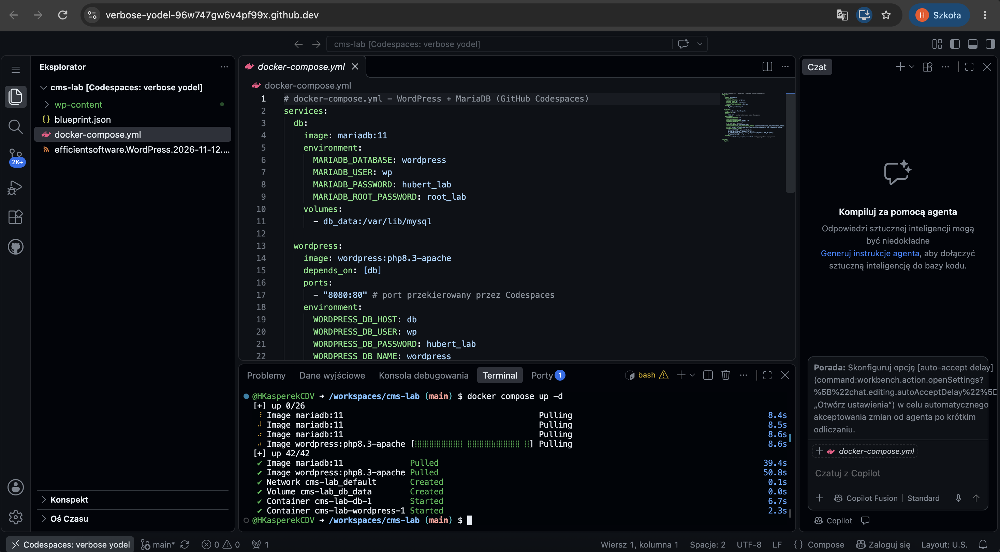
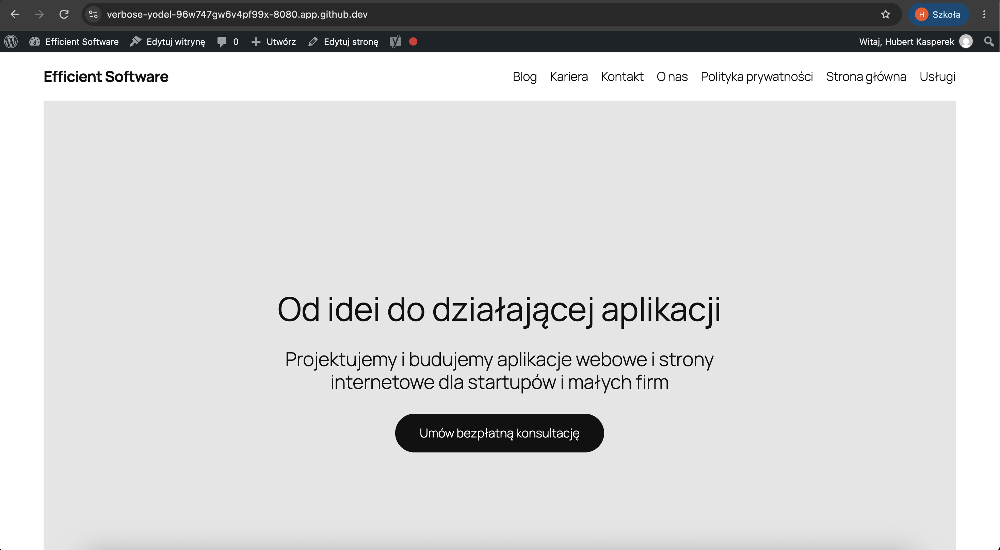

# MP1

Autor: Hubert Kasperek

**Demo z Wordpress Playground**
[Otwórz](https://playground.wordpress.net/?blueprint-url=https://raw.githubusercontent.com/HKasperekCDV/cms-lab/refs/heads/main/blueprint.json)

## Informacje
nazwa fikcyjnej firmy: Efficient Software

slogan: "Od idei do działającej aplikacji webowej"

Branża: Software House

Oferta:
- strony firmowe na Wordpress wraz z ACF
- aplikacje webowe Next.js + Sanity CMS
- sam frontend w Next.js
- utrzymanie i rozwój aplikacji po wdrożeniu
Grupa docelowa:
- małe firmy bez własnej strony internetowej lub chcące mieć redesign strony (nową stronę)
- kandydaci na pracownika

## Persony
1. Marta - założycielka startupu, potrzebuje strony internetowej
   - cel: zbudować mvp aplikacji w 3 miesiące
   - user flow: Homepage -> Usługi -> Kontakt
   - urządzenie: laptop - przegląda różne agencje oferujące tworzenie i utrzymanie aplikacji internetowych
2. Jacek - web developer, student szukający pierwszej pracy jako junior web developer
   - cel: znaleźć pierwszą pracę w firmie, w jakiej będzie się rozwijać
   - user flow: Homepage -> Kariera -> Kontakt
   - urządzenie: smartfon - przegląda strony i oferty w przerwach między zajęciami

## Mapa strony
- Strona główna
- O nas - historia firmy, stosy technologiczne, przykładowi eksperci
- Usługi - oferta i wybrane ukończone projekty (podstrona dla persony Marta)
- Kariera - oferty pracy, benefity, krótkie wyjaśnienie procesu rekrutacji (podstrona dla persony Jacek)
- Blog - artykuły blogowe od ekspertów (użyte placeholdery, ale na realnej stronie artykuły mogłyby zwiększać pozycjonowanie strony w SEO)
- Kontakt - formularz Contact Form 7
- Polityka prywatności

## Wtyczki
Contact Form 7 - dla formularza kontakowego

Yoast SEO - optymalizacja SEO (dla lepszego pozycjonowania w np Google) pod wyszukiwarki

CookieYes - baner cookies 

## Uzasadnienie wyboru CMS
WordPress jest najpopularniejszym CMS'em, ma ogromny ekosystem wtyczek, dzięki jego popularności łatwo jest znaleźć developera jaki zna
WordPressa, w porównaniu np do Wix czy Sanity - WordPress jest self-hosted, czyli nie mamy vendor lock, możemy sami go hostować gdzie chcemy i mamy kontrolę nad kodem i danymi

## Uruchomienie projektu
można jednym kliknięciem korzystając z linka podanego wyżej dla wersji z Demo Playground, natomiast dla wersji w codespaces, 
po uruchomieniu codespaces wystarczy wpisac **docker compose up -d** w terminalu by uruchomić, przygotować WordPressa, zrobić import w:

Narzędzia -> import -> Wordpress i wczytać plik **efficientsoftware.WordPress.2026-11-12.xml** dostępny w repozytorium
